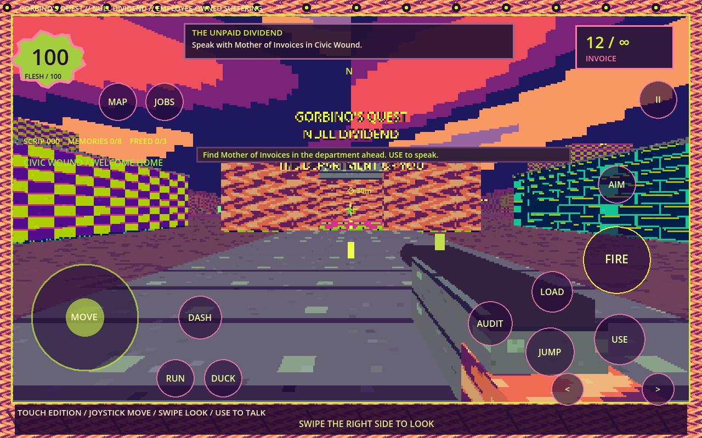

# Android touch edition — 2.1.0-mobile

**[Download the APK](downloads/GorbinosQuest-Android.apk?raw=true)**

Download it on your Android phone or tablet, open the APK, and allow your browser or file manager to install this app if Android asks. Then launch **Gorbino's Quest 3D**. This is a direct APK distribution, not a Play Store listing.

## Requirements

- Android **7.0 or newer** (API 24 minimum).
- ARM64 or ARMv7 processor; both versions are included in the one APK.
- OpenGL ES 3 graphics and a landscape touchscreen.
- Approximately 50 MB download, plus space for installation and saves.

The APK is an offline, signed release build. Its manifest requests no Android permissions. It includes the full city, all quests and side missions, five weapons and three endings from the desktop remake.

## Touch controls

- **Left stick**: move. **Swipe the right side**: look around.
- **Hold FIRE**: shoot. You can also drag on FIRE to adjust aim while shooting. Movement, aiming and firing use independent fingers.
- **USE**: talk, collect, operate terminals, heal at a clinic, and interact with quest objects.
- **JUMP**: hold to jump. **RUN**, **DUCK**, and **AIM** are toggles.
- **DASH**, **AUDIT**, and **LOAD** trigger their corresponding abilities.
- **< / >**: switch among owned weapons.
- **MAP**: city plan. **JOBS**: journal; tap a discovered mission to track it.
- **II**: pause. The pause screen includes save, restore, sound, detail, look-speed, help and title controls.
- Android **Back** pauses gameplay or closes a panel. Dialogues close with a tap, fishing uses a tap on the timing bar, and ending cards are touch-selectable.

Walk into the Department of You ahead of the starting location, look at Mother of Invoices, and tap **USE** to begin the main quest.



## Phone behavior

Landscape orientation is locked. The game preserves its aspect ratio and uses immersive display mode. Low detail renders the 3D view at roughly one-third of the interface resolution; high detail uses one-half. The frame rate is capped at 60 FPS. This cap is not a promise of device performance. Look speed has three settings.

Backgrounding or losing focus pauses and saves active gameplay. Opening a menu clears held touch actions, preventing stuck firing or movement. Saves use app-private storage; no shared-storage permission is needed. Uninstalling removes local save data. New Game replaces the current save.

## Validation and limits

- **40 mobile-input checks passed**, covering independent fingers, look, fire, joystick release, jump, sprint/crouch toggles, weapon cycling, abilities, all menu routes, fishing, endings, Back, and background pause/reset.
- **125 existing gameplay/world/save checks passed** after integrating the port.
- Touch gameplay and pause screens were rendered and visually inspected on Linux with synthetic touch mode.
- The final APK's ZIP integrity, included ARM native libraries, compiled touch scripts, application metadata, landscape orientation, permissions, page alignment, and APK v2/v3 signatures were checked.
- **No physical Android device or Android emulator was available for runtime testing.** Touch simulation and package validation do not establish actual phone compatibility, performance, or thermal behavior.

## Signing and rebuilding

Package: `com.jirotwo.gorbinosquest`

Version: `2.1.0-mobile` / code `3`

Minimum SDK: `24` / target SDK: `36`

Signing certificate SHA-256:

```text
12850acb47c50b05794a105ed1ac3ad8b654f092975c6dff7eb2775ecedc4930
```

Signing keys and passwords are not in this repository. Use your own keystore for your own distribution. For a rebuild, use Godot 4.6.3 with matching Android templates, a configured JDK and Android SDK, and provide `GODOT_ANDROID_KEYSTORE_RELEASE_PATH`, `GODOT_ANDROID_KEYSTORE_RELEASE_USER`, and `GODOT_ANDROID_KEYSTORE_RELEASE_PASSWORD`. Run `tools/build_android.sh`. The preset uses a standard APK template and needs no Gradle build or online service.

Preview and tests:

```sh
godot --path . -- --touch
godot --headless --path . --script verify_touch.gd -- --test --touch
```

Run tests with a separate Godot user-data profile: the checks exercise save and preference behavior. Desktop controls remain available when the touch mode flag is absent.
