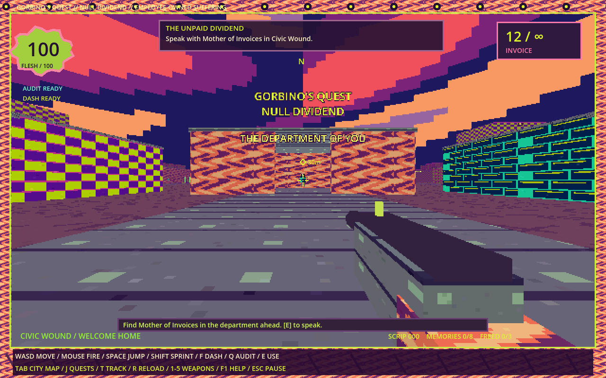
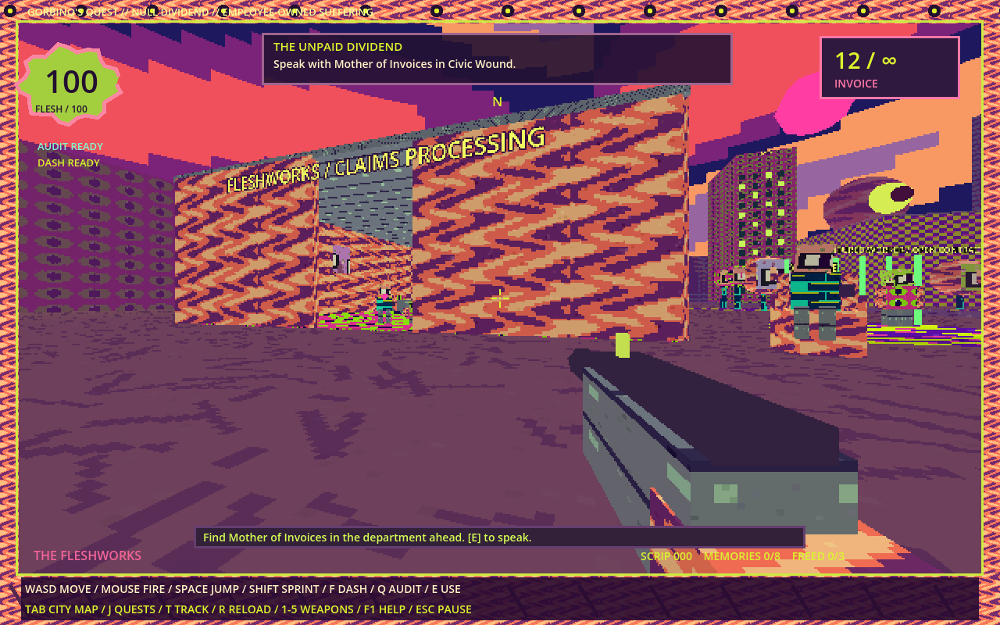
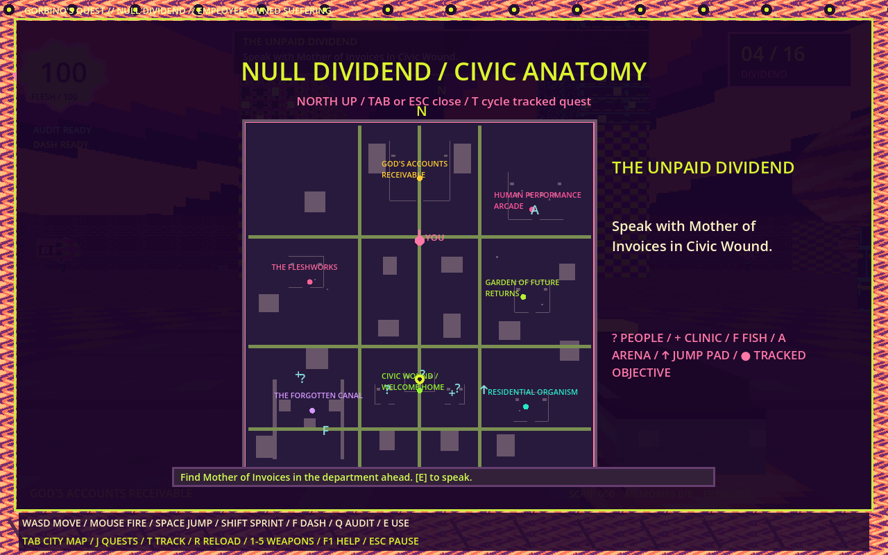

# Gorbino’s Quest 3D: Null Dividend

A complete first-person remake of the earlier 2D fan game. Explore a connected, roughly **280 × 280 metre city** with seven districts, enterable quest buildings, rooftop ramps, a skybridge, NPCs, encounters, and a final boss. Original low-resolution textures, faceted characters, clashing colors, vertex snapping and a biological HUD take their direction from *Cruelty Squad*.

## Download

- **[Android — install APK](downloads/GorbinosQuest-Android.apk?raw=true)**. Full touch edition for Android 7.0+ ARM phones/tablets. Landscape controls, phone detail settings, and background autosave. [Mobile controls and validation](MOBILE.md). Device runtime testing is still pending.

- **[Windows 64-bit — download ZIP](downloads/GorbinosQuest-Windows.zip?raw=true)**. Extract it and run `GorbinosQuest.exe`. No engine, browser, account or Internet connection required.
- **[Linux x86-64 — download archive](downloads/GorbinosQuest-Linux.tar.gz?raw=true)**. Extract and run `GorbinosQuest.x86_64`; use `chmod +x` if needed.

Requires a desktop display and OpenGL 3.3 graphics. Linux was run in a virtual X11 display. **Windows execution has not been tested.** Executables are unsigned.



## Your first job

Walk into the Department of You directly ahead of the starting location. Look at **Mother of Invoices** and press **E**. She starts the main quest: recover ownership seals from Fleshworks, the Garden and Residential Organism; then enter the northern tower, defeat the Final Beneficiary and decide the city's future.

The **Tab map** marks your tracked quest. **J** opens the journal, and **T** cycles active quests. A clinic restores flesh for free and establishes a respawn checkpoint. The vending organ trades 20 scrip for ammunition and a small heal.

## Six side missions

| Mission | Where to start | What you do | Reward |
| --- | --- | --- | --- |
| Collective Bargaining | Loan, Civic Wound union office | Free three contracted workers in the west | MARROW shotgun, +25 maximum flesh, scrip |
| A Heart in Transit | Dr. Nil, Civic Wound clinic | Recover a heart from Residential Organism and return it | DIVIDEND rail driver, healing, scrip |
| Pirate Radio Therapy | Radio Angel, Forgotten Canal | Climb three ramps and retune rooftop transmitters | DIVIDEND rail driver, scrip |
| Performance Review | Human Performance Arcade | Survive three combat waves | DEBT COLLECTOR siphon, scrip |
| The Last Honest Job | Canal fishing point | Land three timed catches | CYST organ mortar, scrip |
| Someone Else's Childhood | Find a memory fragment | Recover six of eight hidden memories | Siphon and access to a hidden ending |

The hidden ending also requires all three workers to be freed. Two other endings are available after defeating the boss. You can explore and do optional jobs in any order.



## Five weapons

- **INVOICE**: fast 10mm pistol with unlimited reserve ammunition. Reload its 12-round magazine. Always available.
- **MARROW**: eight-pellet flechette shotgun, devastating up close.
- **DIVIDEND**: precise rail driver that pierces several bodies. Also hidden on the skybridge for explorers.
- **CYST**: a physical, arcing organ projectile with a splash explosion.
- **DEBT COLLECTOR**: short-range rapid fire that steals flesh on impact.

Headshots deal additional damage. Volatile organ tanks explode and can chain into nearby tanks. Four ordinary enemy types vary between ranged security, fast charging hounds, artillery growths and armored clerks. The final boss fires aimed spreads and radial volleys. Audit Sight can interrupt enemies, reveal memories through walls, and turn nearby bullets into scrip.

## Controls

Android uses a left joystick, right-side swipe look, and touch buttons. Every menu is touch-accessible. See the [Android guide](MOBILE.md). The table below applies to desktop.

| Input | Action |
| --- | --- |
| WASD / arrows | Move |
| Mouse / left click | Look / fire |
| Right click | Focus aim |
| Space / Shift / Ctrl | Jump / sprint / crouch |
| F / Q | Short dash / Audit Sight |
| E | Interact / reel in a fish |
| R / 1–5 / wheel | Reload / choose weapon |
| Tab / J / T | City map / journal / cycle tracked quest |
| F5 / F9 | Save / restore |
| Esc | Pause or close a panel |
| F1 / F3 / F11 / M | Help / reduced effects / fullscreen / mute |

## Saving

Quest progress, discoveries, owned weapons, ammunition, position and defeated enemies autosave every 25 seconds, on quest actions, and when pausing. F5 saves immediately. Clinics establish your reconstruction location. Death retains progress and charges up to 10 scrip. An unfinished arena restarts its waves after loading. Selecting **New Game** replaces the current save. V2 uses its own application data folder, separate from the earlier 2D game.

## Art research and original assets

See [ART-RESEARCH.md](ART-RESEARCH.md) for source links and concrete design decisions. The textures and models in this repository were created for this project; no game assets were ripped. This is an unofficial interpretation, not an affiliated sequel or a claim about canonical Gorbino gameplay. The source interview and transcript were successfully researched for this remake, superseding the limited research of the earlier build.



## Build and verify

Open `project.godot` with **Godot 4.6.3**, install its matching export templates, and use the Windows Desktop or Linux export preset. The downloadable binaries embed their game data.

```sh
godot --headless --path . --script verify.gd -- --test
godot --headless --path . --script traverse.gd --fixed-fps 240 -- --test
godot --headless --path . --script vertical.gd --fixed-fps 60 -- --test
godot --headless --path . --script combat.gd --fixed-fps 120 -- --test
```

Validation includes **125 quest, world, combat and save checks**, physical movement to **10 major ground objectives**, all **five ramp/skybridge routes**, and **seven live weapon/projectile scenarios**. Tests do not establish final human difficulty or balance. Source and packaged Linux rendering were inspected. Godot can emit an AudioStreamGeneratorPlayback cleanup warning on automated exit; no gameplay script errors remained in the validation logs.

Original code and assets: [MIT license](SOURCE-LICENSE.txt). [Godot license](GODOT-LICENSE.txt). Third-party names and fictional properties remain with their creators. No affiliation or endorsement is claimed.
