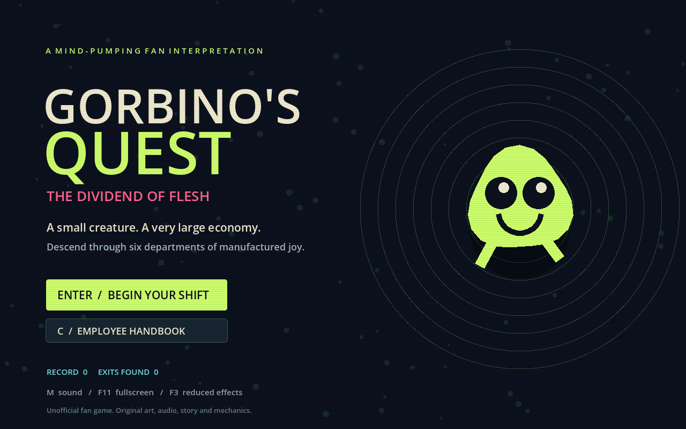
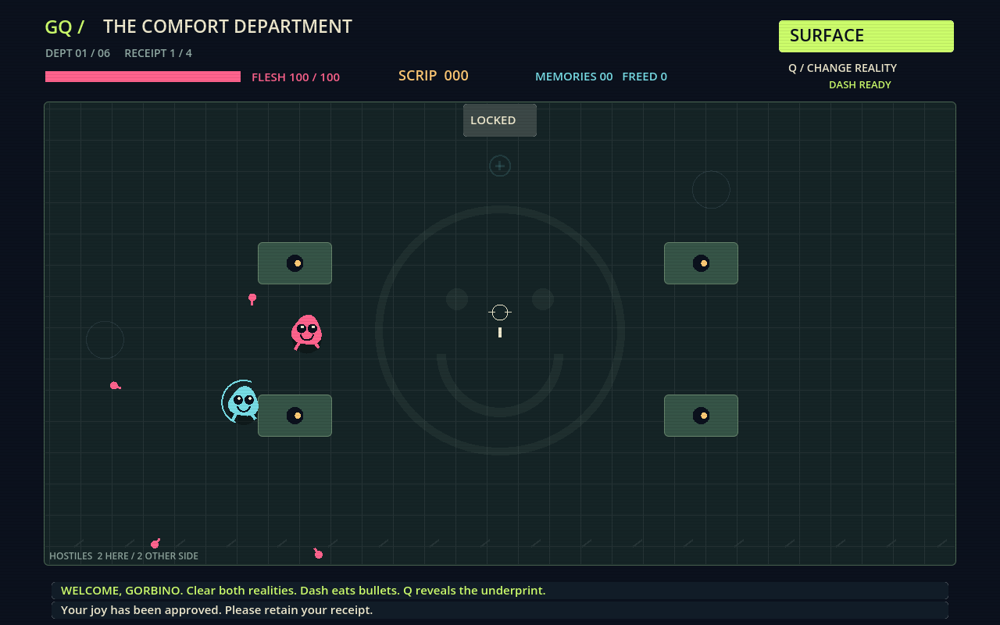

# Gorbino’s Quest: The Dividend of Flesh

An unofficial native desktop fan interpretation inspired by the fictional game in *Cruelty Squad*. All art, music, mechanics and dialogue in this project are original.

## Download and play

- **[Windows 64-bit ZIP](downloads/GorbinosQuest-Windows.zip?raw=true)** — extract it, then double-click `GorbinosQuest.exe`. No engine or browser installation required.
- **[Linux x86-64 archive](downloads/GorbinosQuest-Linux.tar.gz?raw=true)** — extract it, mark `GorbinosQuest.x86_64` executable if needed, then run it.

Requires a desktop display and OpenGL 3.3 graphics. Linux was tested in a virtual X11 display. The Windows executable was exported and its format checked, but has not been run on Windows. Executables are unsigned.



## Play

Move with **WASD / arrows**, aim with the **mouse**, and hold **left click** to fire. **Space** dashes through bullets, absorbing them into money. **Q** switches realities; clear enemies on both sides. **E** uses the northern elevator after a room is cleared. **1 / 2 / 3**, or click, selects a card. **Esc** pauses. **M** mutes, **F11** toggles fullscreen, and **F3** reduces effects.

Six departments and 24 encounters lead through two overlapping realities. Collect eight types of graft, combine ricochets with spread shots and leech, shop for upgrades, gather lost memories, and decide whether to spend your money on yourself or free strangers. Three endings include a hidden route. Runs do not save mid-campaign; records and preferences persist.



## Source and verification

Open `project.godot` in **Godot 4.6.3**. Install matching export templates to use the Windows and Linux export presets.

```sh
godot --headless --path . --script verify.gd
```

291 automated checks cover all 24 rooms, all three endings, projectile impact, phase isolation, ricochet, movement collision, dash absorption, grafts, spending and one-time secrets. Progression tests clear encounters programmatically; they do not establish human completion or final balance. A generator playback cleanup warning may appear on automated exit.

The [full handbook](README.txt) documents controls, saving, research limitations and validation. Fan wiki access was blocked during development, so this is an original interpretation rather than a claim to reproduce canonical Gorbino gameplay or 500 hours of content.

Original software uses the [MIT license](SOURCE-LICENSE.txt); [Godot’s license](GODOT-LICENSE.txt) is included. Third-party names and fictional properties remain with their respective creators. No affiliation or endorsement is claimed.
