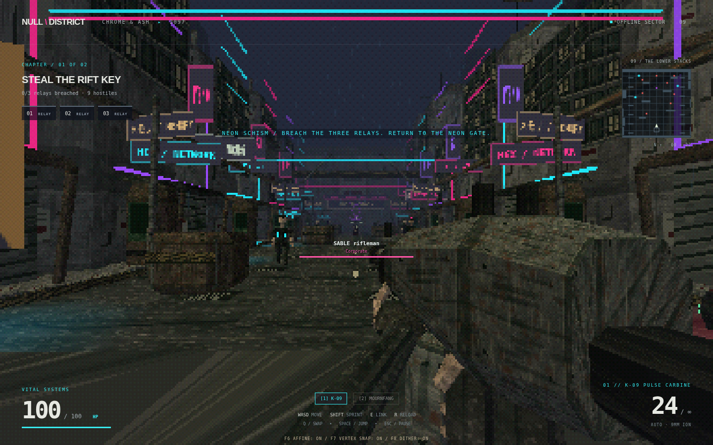
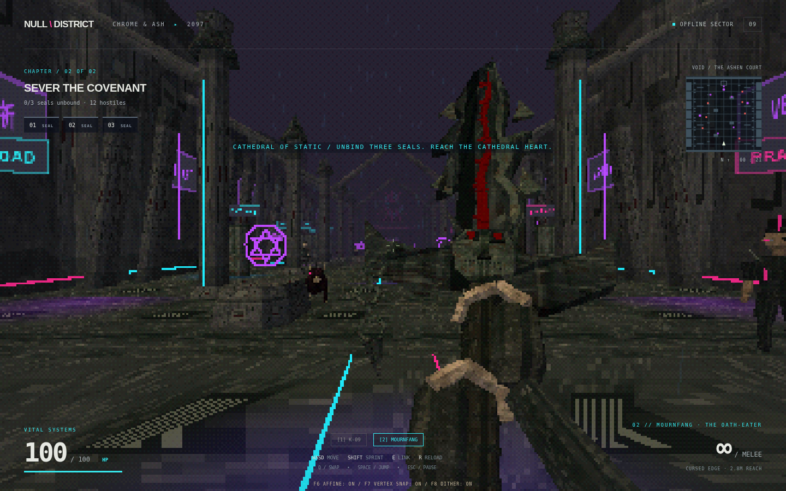

# NULL DISTRICT — Chrome & Ash

A standalone cyberpunk FPS with a custom PS1-style raster pipeline, faceted characters and weapons, pixel-painted environments and real affine texture mapping. This separate game does not modify or replace Dreadwake.





Version 1.4 turns NULL DISTRICT into **Chrome & Ash**, a two-chapter collision of grunge cyberpunk and high/dark fantasy. Dirty concrete, corroded steel and worn fabric remain beneath a much stronger layer of cyan/magenta/violet signage, neon conduits, pixel-lit pavement and dimensional sigils. The affine shader, vertex snapping, dithering and RGB555 pipeline are unchanged.

**Chapter 01 — Neon Schism.** Corporate patrols and street syndicates defend the lower stacks as knights, spellcasters and a rift hound spill into the district. Breach three relays and return to the neon gate at spawn. Choose **Enter Chapter 02** on the completion screen.

**Chapter 02 — Cathedral of Static.** A wider ruined cathedral with a nave, side chapels, flying buttresses, tombs, server racks and a shattered neon rose window. Unbind three guarded seals, then advance to the heart at the north end. A winged sentinel guards the final approach. This is a different map with its own bounds, cover, encounters and exit.

Both chapters are selectable from the main menu. Starting Chapter 02 directly is supported. A campaign transition carries kills, elapsed time and both weapons; health and the magazine replenish at the chapter checkpoint. Restart resets the current chapter, including enemies, objectives, medkits and projectiles.

### Hostile archive


| Faction | Archetype | Combat |
| --- | --- | --- |
| Corporate | SABLE rifleman | Aimed rifle fire; 3 HP |
| Street syndicate | Razor street runner | Fast machete rush; 3 HP |
| Street syndicate | HEX netrunner | Dodgeable cyan data bolts; 3 HP |
| Corporate | Bastion riot officer | Shield/helmet silhouette, burst fire; 6 HP |
| Ashen court | Ashbound black knight | Plated armor, shield and long melee reach; 6 HP |
| Ashen court | Thorn oath arbalist | Cloak, hood and crossbow; 3 HP |
| Veiled covenant | Veil blood warlock | Robes, staff and slow blood-magic orbs; 4 HP |
| Breachborn | Rift hound | Spined quadruped with a fast biting rush; 3 HP |
| Breachborn | Ossuary revenant | Skeletal, jointed undead claw fighter; 4 HP |
| Breachborn | Cathedral winged sentinel | Large horned stone demon with animated wings and orbs; 9 HP |

These are actual polygonal meshes, not sprite substitutions. Seven human types retain exposed sculpted faces; three monster types use independent skeletons/silhouettes. Body counts range from 526 to 1,788 triangles. Melee and ranged attacks have visible wind-ups and expanding ground warnings. Moving out of reach, strafing the locked aim or taking cover can evade attacks. Bolts and orbs travel through the world and stop at solid cover; swept collision prevents fast projectiles tunneling through the player. Targeting an enemy displays its faction, name and remaining health.

The two starting weapons retain their articulated first-person grips and fixed-length arm IK. MOURNFANG still animates its fangs, runes, ruby and linked chain at rest, and alternates slashes with a blade-following trail. Armored enemies need two sword hits. Dreadwake remains untouched.

## Play on Windows

1. Download **[NULL-DISTRICT-1.4.0-Windows-x64.exe](https://github.com/jirotwo-create/browser-game/raw/refs/heads/codex/null-district-fps/NULL-DISTRICT-1.4.0-Windows-x64.exe)** from this branch. If GitHub opens a file page, choose **Download raw file**.
2. Double-click the downloaded `.exe`. It opens its own game window. No installation, browser, Python, Node.js, server, internet connection or additional game files are needed.
3. Choose **Enter the district**.

Requires **64-bit Windows 10 or Windows 11**, a graphics driver with WebGL support, and keyboard/mouse. The executable is an unsigned prototype build. `null-district.zip` is the source code, not the Windows game.

- **WASD** move, **mouse** aim, **left click / hold** fire the carbine or swing MOURNFANG.
- Both weapons are available immediately: **1** equips the carbine, **2** equips the sword. **Q** or the **mouse wheel** cycles weapons.
- MOURNFANG has a 2.8m melee reach, a visible wind-up, a sweeping attack and a recovery cooldown. It can cleave nearby enemies for 3 damage, respects cover and never consumes bullets. Switching weapons cancels an unfinished swing or reload; it does not refill the magazine.
- **Shift** sprint, **Space** jump, **R** reload, **Escape** pause.
- **F6** compares affine and perspective-correct texture mapping. **F7** toggles vertex snapping; **F8** toggles dithering. These retro effects start enabled.
- **F11** or **Alt+Enter** toggle fullscreen. Close the window or use **Alt+F4** to quit.
- Defeat the mixed factions. Cyan/purple squares on the minimap mark relays/seals. Approach a node, clear nearby hostiles, and **hold E** to breach or unbind it.
- In Chapter 01, breach all three relays and return to the gate at spawn; **E** opens the chapter transition. In Chapter 02, unbind all three seals and reach the north gate; **E** seals the rift and completes the campaign.
- Rotating cross-marked crates restore 40 health when walked over. Ammunition reserves are unlimited; magazines hold 24 rounds.
- The pause and end screens let you restart. Progress lasts for the current run only; chapter selection is always available.

## Desktop build from source

The executable bundles Electron, the game and all graphics. The desktop launcher serves files through an in-process local protocol; it does not run an HTTP server or open an installed browser. The renderer is sandboxed with Node.js disabled and context isolation enabled.

For development, install Node.js 24 LTS. From the repository root or extracted source ZIP:

```sh
cd null-district
npm ci
npm start
```

Create a single portable Windows executable:

```sh
npm run dist:win
```

Output: `dist/NULL-DISTRICT-1.4.0-Windows-x64.exe`. The pinned dependencies and lockfile reproduce the build. The Windows target is x64; no signing certificate is configured. The build can also be produced on Linux without Wine. Downloading dependencies and runtime binaries requires internet access at build time only.

`npm run preview` retains the optional browser development workflow on port 4180. Python 3 is needed only for that optional preview.

## Rendering and validation

The [graphics pipeline documentation](graphics/README.md) describes the renderer, authored polygon budgets, texture palette and GPU interpolation test. Three.js 0.180.0 is bundled under its MIT license in `vendor/`. Audio is synthesized locally.

```sh
npm run check
node tests/desktop.cjs
```

Desktop tests use Playwright from `/workspace/dreadwake-tools` by default; set `PLAYWRIGHT_MODULE` to another installation. Linux desktop tests need a display (or Xvfb); Windows can use its normal desktop. The desktop smoke test exercises local module loading, WebGL, real mouse capture, movement, both starting weapons, a sword swing, shooting, reload, pause/restart, fullscreen and renderer isolation. Set `ELECTRON_EXECUTABLE` and `NULL_DISTRICT_APP` to test a packaged build.

With `npm run preview` running, `node tests/render.cjs` verifies real GPU affine interpolation against CPU barycentrics, vertex snapping and RGB555 output.

`node tests/grips.cjs` checks 223 recoil/reload/alternating-swing poses for fixed arm lengths, wrist attachment, trigger contact, wrapped fingers, correct left/right anatomy, visible hands and animated blade parts.

`node tests/weapons.cjs` verifies starting inventory, the mixed enemy roster, weapon switching, melee range, one hit per swing, cooldown, lethal melee damage, ammunition preservation, reload cancellation and restart.

`node tests/combat.mjs` checks telegraphs, attack cooldowns, melee facing/range/cover, locked firearm aim, projectile launch and swept collisions. `node tests/roster.cjs` checks all ten actual enemy meshes and animated joints; `tests/roster.html` is the model review scene.

With the preview running, `node tests/campaign.cjs` plays both chapters using real mouse/keyboard input: combat, navigation, all six nodes, the chapter transition, carried inventory/kills, final victory, restart and chapter selection. It does not teleport the player, grant health or force objectives. `node tests/mission.cjs` runs the same campaign test; `node tests/smoke.cjs` retains basic controls coverage. The desktop package and its equivalent Linux build have matching game code/assets; the packaged Linux desktop workflow was tested here. The Windows executable was cross-built and its contents verified, but it has not been run on a Windows machine in this environment.

This prototype has two handcrafted chapters. Touch controls and multiplayer are not implemented.
