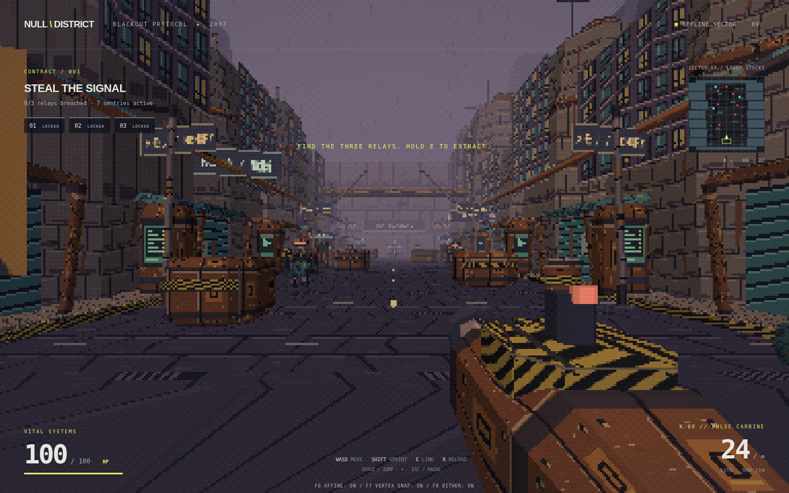

# NULL DISTRICT — Blackout Protocol

A standalone cyberpunk FPS with a custom PS1-style raster pipeline, faceted characters and weapons, pixel-painted environments and real affine texture mapping. This separate game does not modify or replace Dreadwake.



Version 1.1 replaces the original box-based scene with angular SABLE guards, a modeled K09 carbine and arms, shuttered shops, rooftop tanks, ventilation, industrial cover and painted posters. The 240-line renderer applies screen-space affine UVs, projected vertex snapping, nearest-neighbor texture sampling, Gouraud lighting, ordered dithering and RGB555 color.

## Play on Windows

1. Download **[NULL-DISTRICT-1.1.0-Windows-x64.exe](https://github.com/jirotwo-create/browser-game/raw/refs/heads/codex/null-district-fps/NULL-DISTRICT-1.1.0-Windows-x64.exe)** from this branch. If GitHub opens a file page, choose **Download raw file**.
2. Double-click the downloaded `.exe`. It opens its own game window. No installation, browser, Python, Node.js, server, internet connection or additional game files are needed.
3. Choose **Enter the district**.

Requires **64-bit Windows 10 or Windows 11**, a graphics driver with WebGL support, and keyboard/mouse. The executable is an unsigned prototype build. `null-district.zip` is the source code, not the Windows game.

- **WASD** move, **mouse** aim, **left click / hold** shoot.
- **Shift** sprint, **Space** jump, **R** reload, **Escape** pause.
- **F6** compares affine and perspective-correct texture mapping. **F7** toggles vertex snapping; **F8** toggles dithering. These retro effects start enabled.
- **F11** or **Alt+Enter** toggle fullscreen. Close the window or use **Alt+F4** to quit.
- Clear the red-visored sentries. Blue squares on the minimap mark relays. Approach a relay, clear nearby guards, and **hold E** to breach it.
- Extract all three relays, return to the lime uplink at the starting end of the avenue, and press **E** to finish.
- Rotating cross-marked crates restore 40 health when walked over. Ammunition reserves are unlimited; magazines hold 24 rounds.
- The pause and end screens let you restart. Progress lasts for the current run only.

## Desktop build from source

The executable bundles Electron, the game and all graphics. The desktop launcher serves files through an in-process local protocol; it does not run an HTTP server or open an installed browser. The renderer is sandboxed with Node.js disabled and context isolation enabled.

For development, install Node.js 24 LTS. From the repository root or extracted source ZIP:

```sh
cd null-district
npm ci
npm start
```

Create a single portable Windows executable:

```sh
npm run dist:win
```

Output: `dist/NULL-DISTRICT-1.1.0-Windows-x64.exe`. The pinned dependencies and lockfile reproduce the build. The Windows target is x64; no signing certificate is configured. The build can also be produced on Linux without Wine. Downloading dependencies and runtime binaries requires internet access at build time only.

`npm run preview` retains the optional browser development workflow on port 4180. Python 3 is needed only for that optional preview.

## Rendering and validation

The [graphics pipeline documentation](graphics/README.md) describes the renderer, authored polygon budgets, texture palette and GPU interpolation test. Three.js 0.180.0 is bundled under its MIT license in `vendor/`. Audio is synthesized locally.

```sh
npm run check
node tests/desktop.cjs
```

Desktop tests use Playwright from `/workspace/dreadwake-tools` by default; set `PLAYWRIGHT_MODULE` to another installation. Linux desktop tests need a display (or Xvfb); Windows can use its normal desktop. The desktop smoke test exercises local module loading, WebGL, real mouse capture, movement, shooting, reload, pause/restart, fullscreen and renderer isolation. Set `ELECTRON_EXECUTABLE` and `NULL_DISTRICT_APP` to test a packaged build.

With `npm run preview` running, `node tests/render.cjs` verifies real GPU affine interpolation against CPU barycentrics, vertex snapping and RGB555 output.

The original browser smoke and mission tests remain in `tests/smoke.cjs` and `tests/mission.cjs`; start `npm run preview` first. They cover the complete combat/relay/extraction loop. The desktop package and its equivalent Linux build have matching game code/assets; the packaged Linux desktop workflow was tested here. The Windows executable was cross-built and its contents verified, but it has not been run on a Windows machine in this environment.

This is one handcrafted mission, not a full campaign. Touch controls and multiplayer are not implemented.
