# NULL DISTRICT — Chrome & Ash

A standalone cyberpunk FPS with a custom PS1-style raster pipeline, faceted characters and weapons, pixel-painted environments and real affine texture mapping. This separate game does not modify or replace Dreadwake.

**[Download the latest Windows EXE](https://github.com/jirotwo-create/browser-game/raw/refs/heads/codex/null-district-fps/NULL-DISTRICT-1.16.0-Windows-x64.exe)** — standalone, offline, no browser or installation needed.

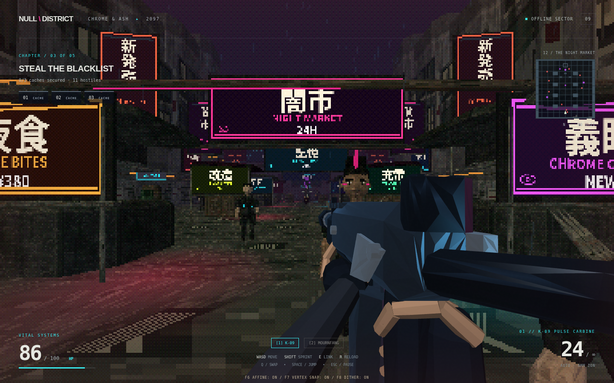

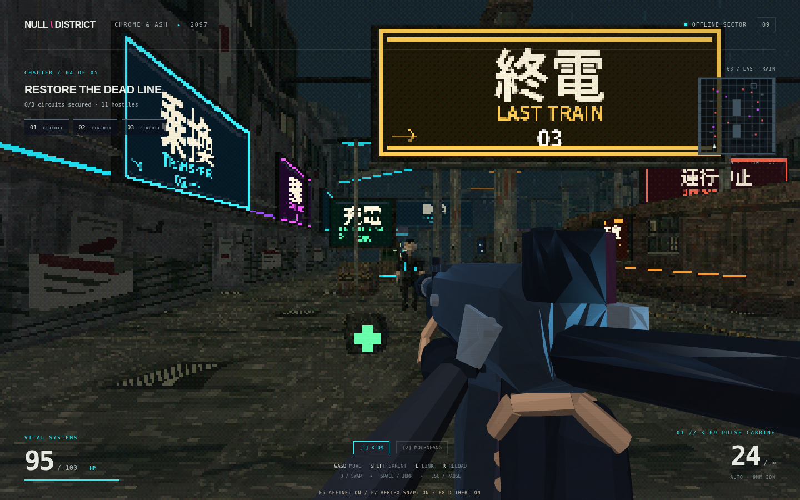

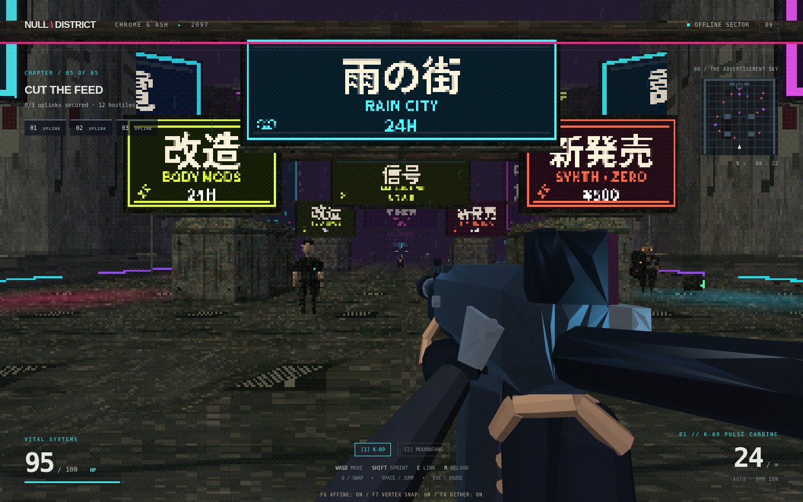

Version 1.16 replaces the barely visible smoke ripple with **ten seconds of animated peripheral spirals**.

- After a completed puff, buildings, pavement, signs and enemies at the edges twist, breathe and ripple continuously, even when you stand still. The center has only a tiny ripple so targets stay readable. The strongest swirl is outside your focus area.
- A quick ease-in leads into a sustained effect, then a smooth fade during the final 1.5 seconds. Healing remains 25 HP, with the same twelve-second cooldown. Hands, gear and HUD stay clear. Holstering keeps the effect; pause freezes it; restart/chapter changes clear it.
- [Rendering and verification notes](graphics/PERIPHERAL-HIGH.md).

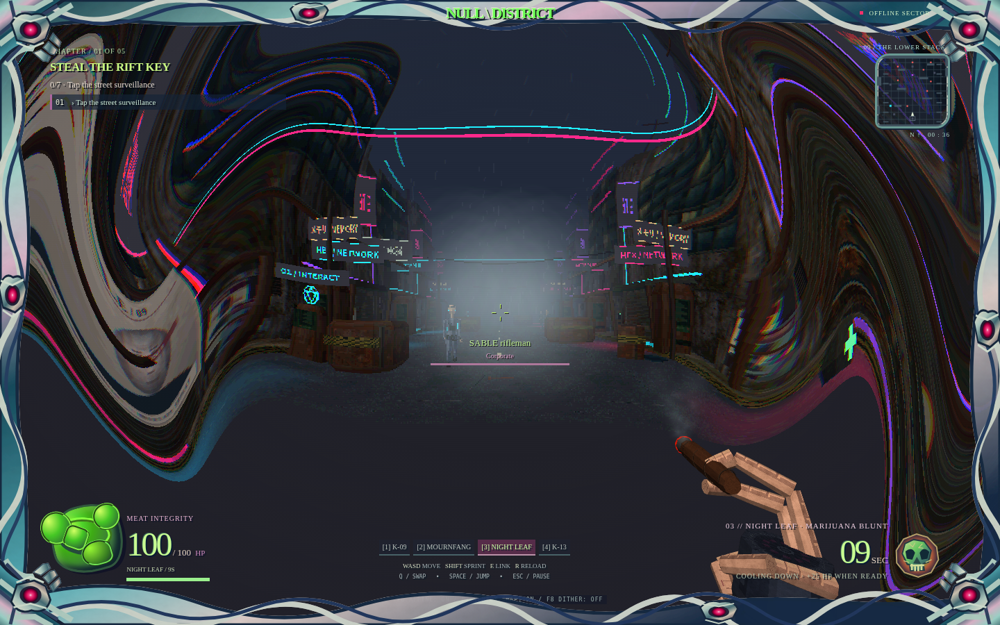

Version 1.15 originally added a brief Night Leaf screen effect and reworks both firearms in darker, tapered gunmetal.

- On the completed exhale, a **4.2-second** edge-weighted ripple (replaced by the stronger ten-second effect in 1.16) and subtle color separation ease in and fade away. The center aim area, HUD and native-resolution gear stay clear. It changes no camera angles, movement, aiming or damage. Cosmetic puffs at full health work too; interrupted inhales do not trigger it. Holstering preserves the short effect, pause freezes it, and chapter loads/restarts clear it.
- **K-13 pistol:** darker oxidized steel, grease, sparse worn edges, unequal receiver shoulders and side hardware. Its exposed six-sided barrel progressively narrows toward a slim, offset muzzle. The violet sight and long-barrel reference silhouette remain.
- **K-09 rifle:** matching worn gunmetal, an asymmetric receiver/fore-end, tapered offset barrel and smaller muzzle hardware. Its stock/sight and lower ready position make the new shape clearer while retaining the exact two-hand grip and reload animation.
- The original PSX affine texture mapping and the opening cutscene remain intact. [Implementation and checks](graphics/EXHALE-GUNMETAL.md).

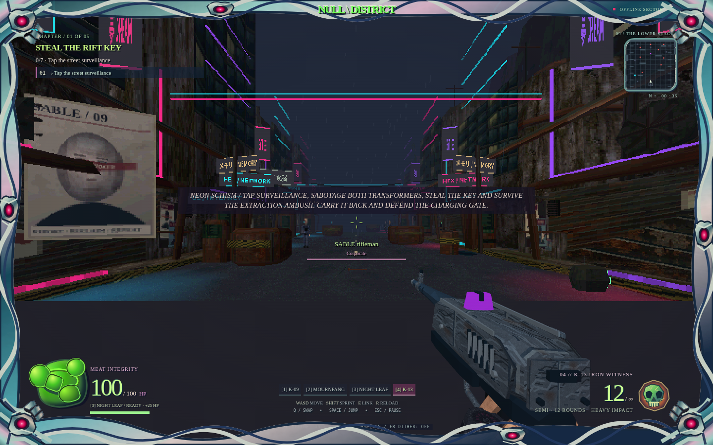

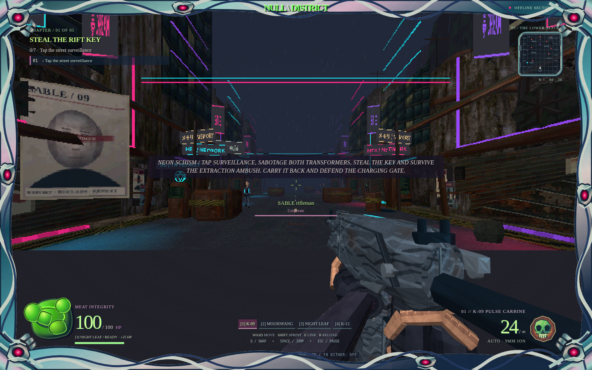

Version 1.14 adds **Chrome & Ash**, an original, fully staged opening prologue.

- **About 98 seconds**, ten moving-camera shots, four speaking characters and nineteen locally bundled, processed synthetic voice lines. Courier 09, the dead engineer Vesper, Sable Customer Care and the Ash Regent establish why the city is harvesting souls, why your own account is marked deceased, what Mournfang can cut, and how the five chapters lead to stopping the Rainline broadcast.
- Real in-engine scenes include the neon city, cathedral, captive-processing room, courier's receipt, Vesper's hologram, the sword reveal, night market, dead-line terminal and Regent's broadcast platform. Rain, soul transfers, gestures, voice-driven mouth movement, sword sheen/chains, a procedural score and cinematic captions accompany the camera moves.
- The opening plays on your first Chapter 01 deployment. **Space** pauses/resumes, **M** toggles audio, and **Enter / Esc / Skip** bypass it. Natural completion waits for **Take Control**. Restarts enter gameplay directly; **Watch Opening** replays it from the menu. All voices work offline.
- Read the [story, controls and production notes](graphics/PROLOGUE.md).

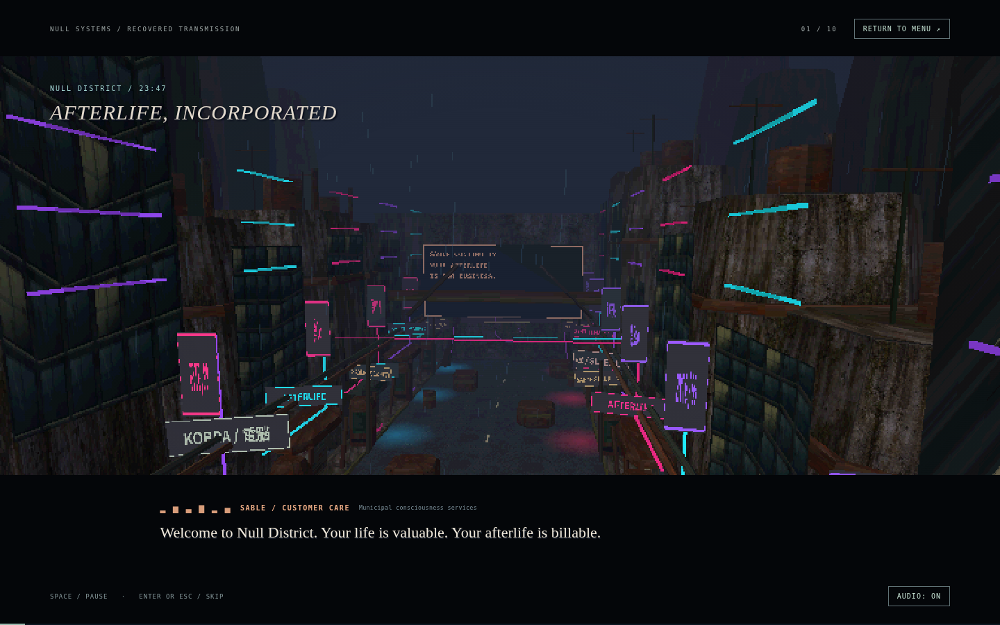

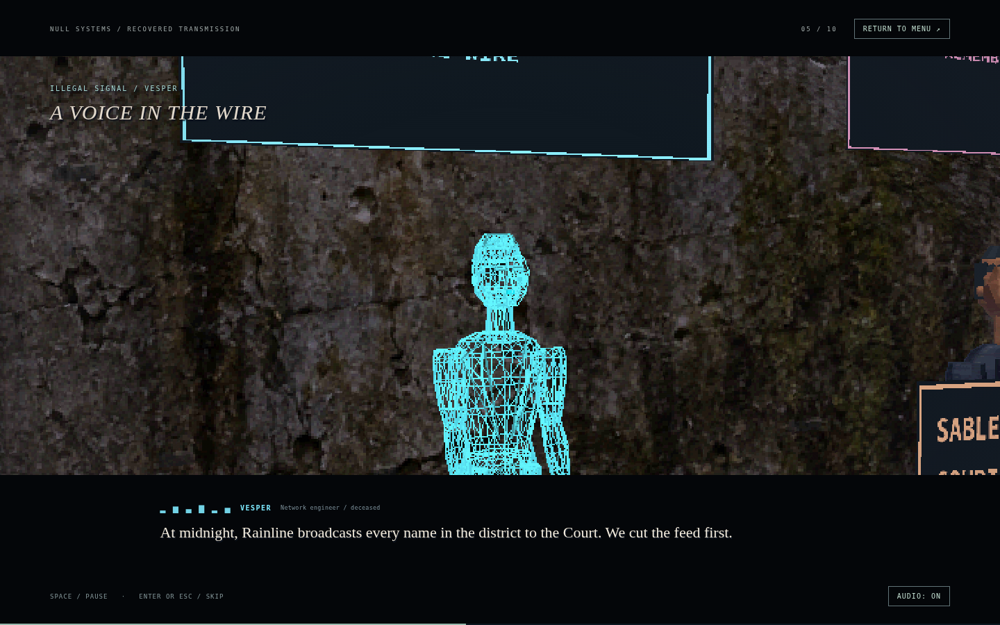

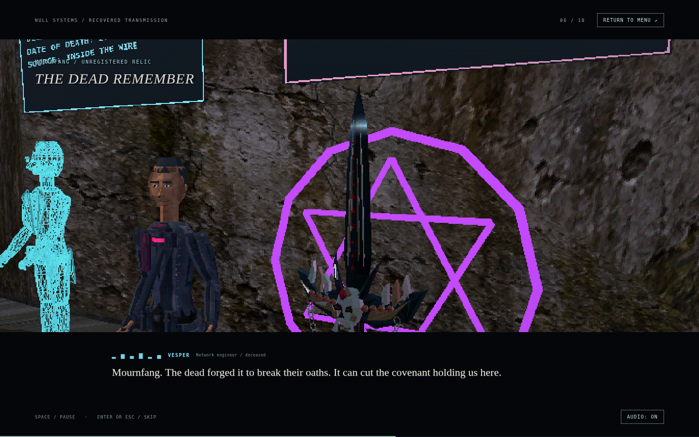

Version 1.13 rebuilds the pistol directly around the supplied No Players Online reference's visible proportions and color treatment.

- A long exposed six-sided barrel leads into a heavy, sloped **cold-silver receiver**. Bright blue-white distressed steel, dark recesses and a prominent solid violet rear sight replace the short dark receiver and added saw teeth. The large rear serial label is removed.
- The lower-right view shows more of the barrel's length and the receiver's top and side. It still clears the center aim view and preserves exact hand contact, recoil, empty slide lock, independent 12-round magazine and animated reload.
- The unseen side, grip and front mechanism are inferred as consistent original geometry; this is an interpretation of the supplied partial image, not an extracted game asset.

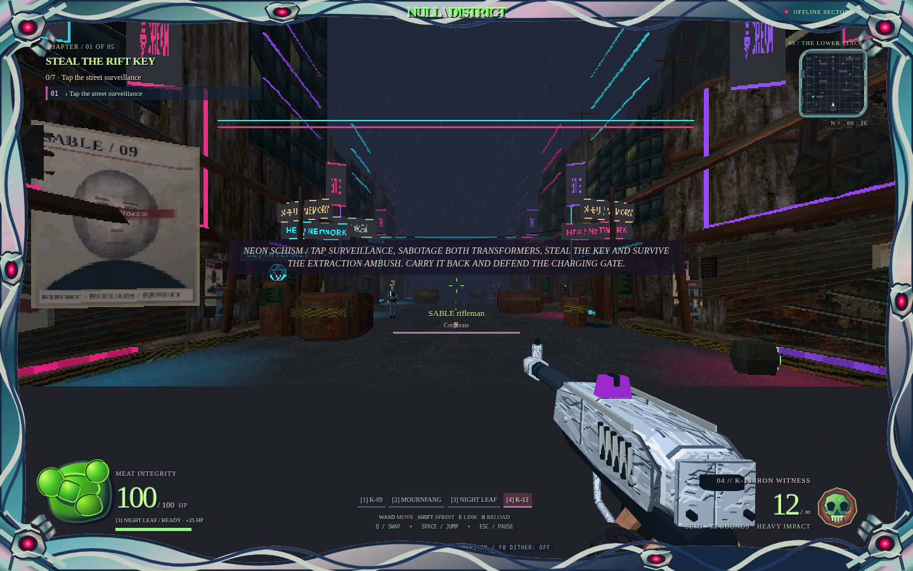

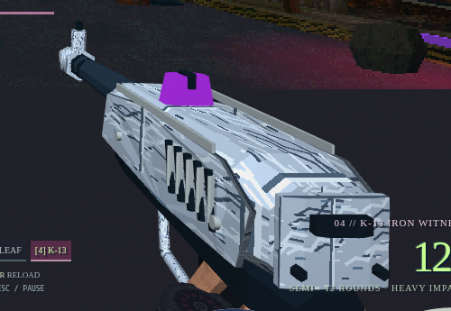

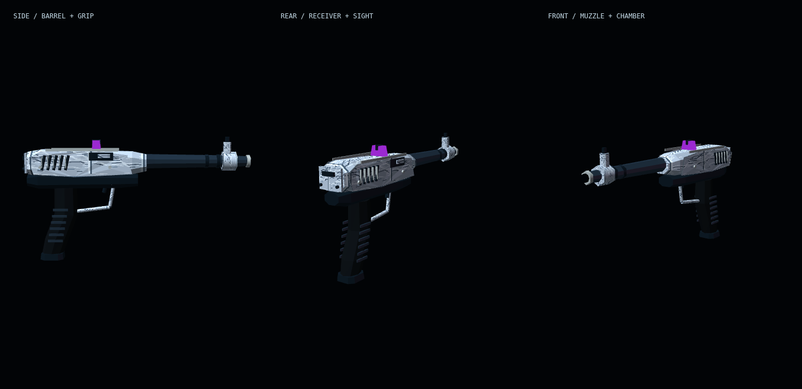

Version 1.12 reworks the full game's material art and replaces the terminal UI with a biomechanical collage.

- **Photographic-style grunge:** an original generated scan atlas supplies spalled concrete, rusted steel, damp brick and worn asphalt. All world maps are now **512px**, with sharp cracks, seams, pitting, soot and grime. Separate cathedral stone, terminal tile and rooftop bitumen floors give the chapters distinct surfaces. The large Sable portrait and legacy signs are also repainted at higher resolution.
- **Characters and gear:** **256px** face, skin, fabric and armor maps add pores, creases, weave and wear to the slim polygonal humans. Monsters gain distinct scarred flesh and bone surfaces. Player streetwear, firearms, leaf wrapper and black-steel sword gain finer material detail; Mournfang's animated sheen remains.
- **Sharper retro output:** **480-line** world rendering, nearest sampling, RGB555, vertex snapping and the existing affine mapping/close-ground relief. Gear/body/smoke still render independently at native resolution. The floor's photographic detail has restrained contrast; there is no film-grain overlay. F8 still enables optional subtle dithering.
- **Surreal interface:** original tendon/ceramic screen frame, swollen green health emblem, skull ammunition seal, four-eyed cable-bound idol, distorted green serif title and irregular curved menu buttons. Its direction draws from Cruelty Squad community HUD references, with original artwork and no strobing. Details and research limits are documented in [Art direction](graphics/ART-DIRECTION.md).

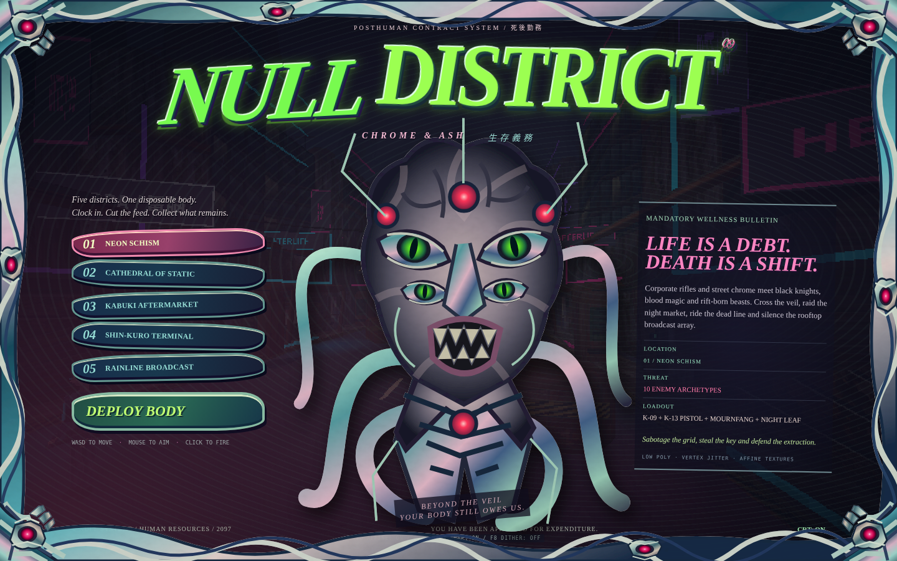

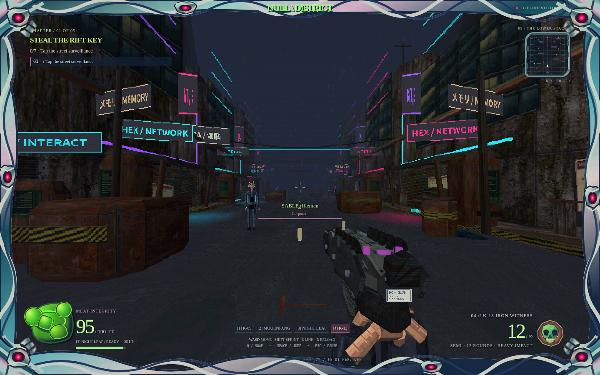

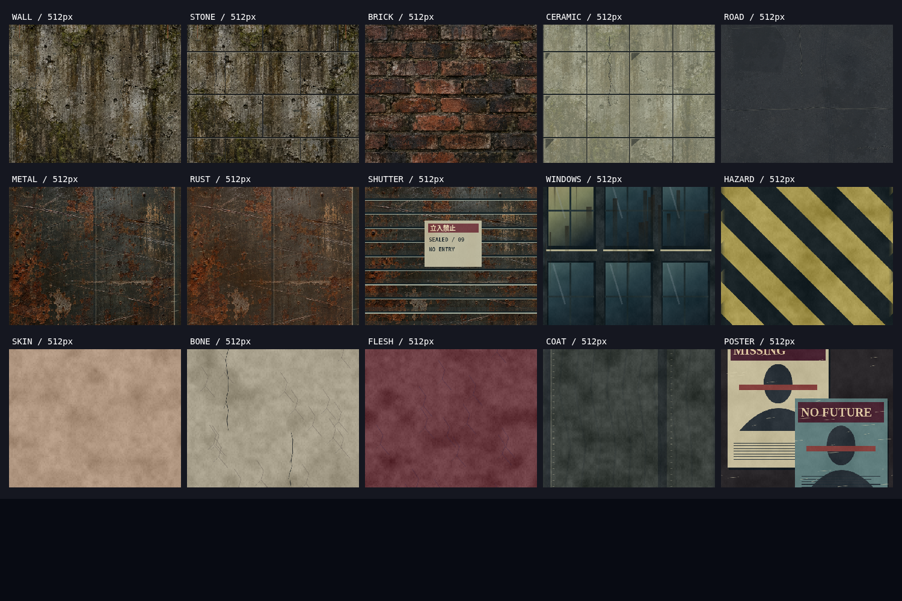

Version 1.11 rebuilds the title screen and HUD as a dystopian employee reanimation terminal, and makes the K-13 more rugged.

- Original fleshy one-eyed effigy artwork, a toxic-yellow halo, pink/green beveled terminal windows, tilted type and corporate mortality notices replace the restrained neon menu. Chapter selection, pause, health/ammo, mission tracking and loadout share the new palette. The center of the gameplay view stays clear; the collage uses static patterns rather than flashing effects.
- The pistol has a heavier faceted slide with jagged steel cheeks, cut-metal teeth, an impact shroud, exposed recoil housing, hooked hammer and angular fasteners. Darker worn-metal paint replaces the cleaner blue-gray finish. Its lower/farther ready position, exact hand contacts, semi-auto behavior and reload animation remain.
- Title controls and navigation were checked at 1440×900, 960×640, 800×600 and 390×844. The desktop package includes all UI art/styles locally and requires no internet.

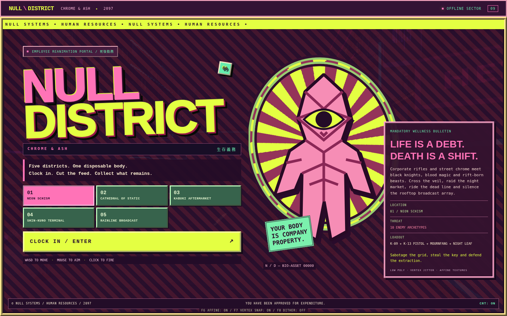

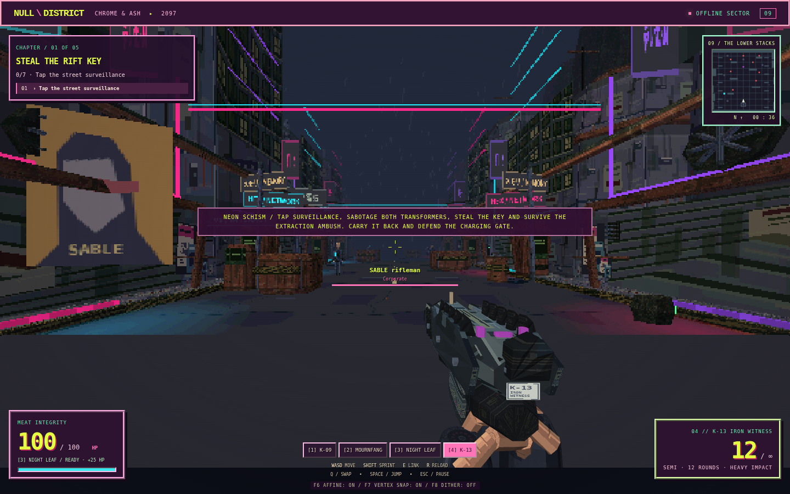

Version 1.10 cleans up the environment, rebuilds the seven human NPC types and lowers the pistol.

- The floor uses restrained asphalt paint with designed cracks, repair patches and abrasion marks. Dense random grain layers have been removed from road maps and greatly reduced on walls and hardware. The film-grain overlay is disabled, scanlines are faint, and ordered dithering starts off; **F8** enables a subtle version if desired.
- The world now renders at **360 lines**, up from 240, with nearest-neighbor presentation. Material details, distant signs and human faces read more clearly while retaining pixel edges, RGB555 colors, vertex snapping and the existing affine warping/close-ground relief. Player equipment still renders at native resolution.
- All **seven human archetypes** use newly authored slimmer anatomy, revised head proportions, jaw/cheek geometry, modeled eyes/ears, segmented fingers, tailored clothing, belt fittings and boots. New 128px facial/clothing/armor paint adds readable features without random speckles. Softer triangular sculpting retains deliberate polygonal planes. Their distinct gear, health, combat roles and animations remain; the three monster types retain their geometry.
- **K-13 pistol** ready position is roughly 10 cm lower and 17 cm farther from the eye. It occupies less of the screen, with both wrists still attached to fixed-length arms throughout recoil/reload. Its 12-round magazine, semi-auto firing and two-damage hits are unchanged.

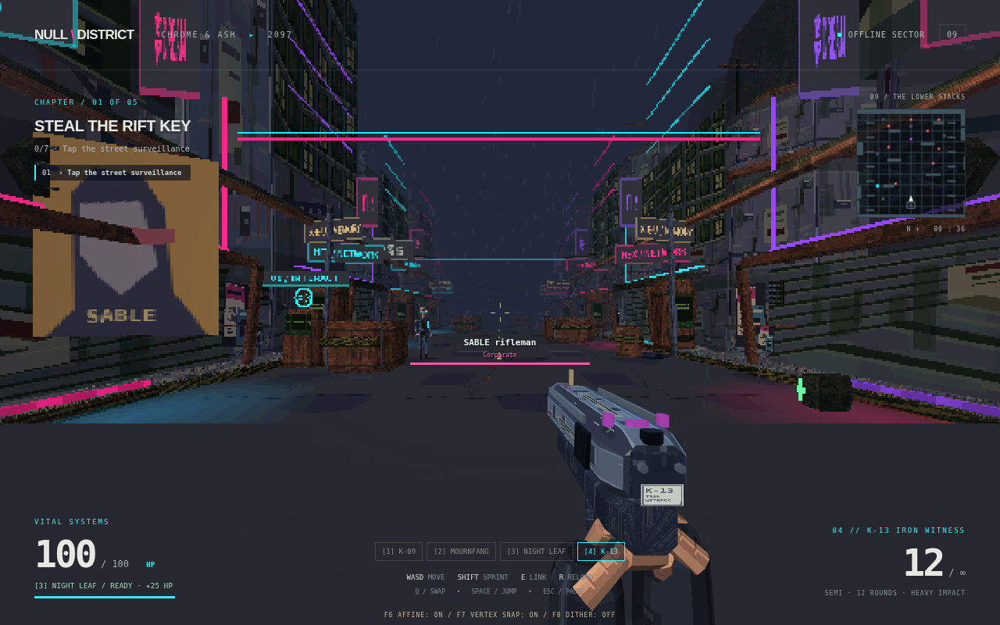

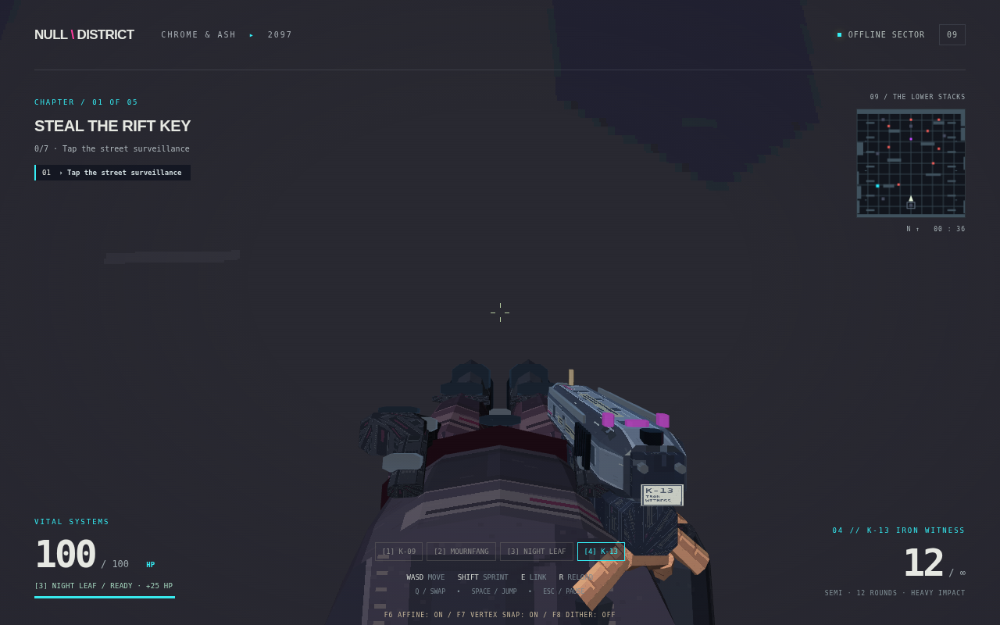

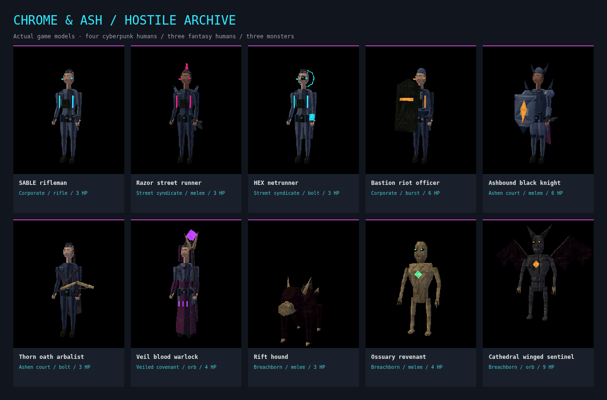

Version 1.9 adds the **K-13 IRON WITNESS pistol** and a refinement pass on the player and all five environments.

- **4** equips the new permanent sidearm: a heavy angular pistol with point-filtered painted steel, bevels, machined panels, a recessed ejection port, magenta sights, a maker’s plate and an open muzzle. Its original design takes visual cues from the supplied No Players Online reference.
- It fires **one shot per click**, deals **2 damage**, holds **12 rounds** and reloads with **R** in **1.7 seconds**. Its magazine is independent of the carbine’s. The slide recoils and locks back when empty; the support hand reaches for the magazine during reload. Switching cancels reload without refilling either gun.
- The player wears painted courier streetwear: reinforced fingerless gloves, sculpted jacket folds and cuffs, a buckled harness, a utility belt, cargo trousers, knee plates and lace-up armored boots. A headless first-person torso and articulated legs are visible when looking down and animate while walking.
- Environment paint now uses **128px point-filtered maps** for finer close detail, with casting seams, chipped concrete, rebar stains, metal wear, road cracks and aggregate. Character/gear paint remains a deliberate 64px. Added wall cabinets, pipe clamps, cable runs, layered paper posters, grilles, gutters, drains and wet patches are batched by material. The terminal gains tiled wainscoting; the cathedral retains its ruined masonry and ritual fittings.
- World/enemy affine warping, near-ground relief, vertex snapping, dithering and pixelation remain. Player gear and the new body stay sharp at native resolution, with perspective-correct painted textures. All 38 objectives and existing blood/smoking mechanics remain.

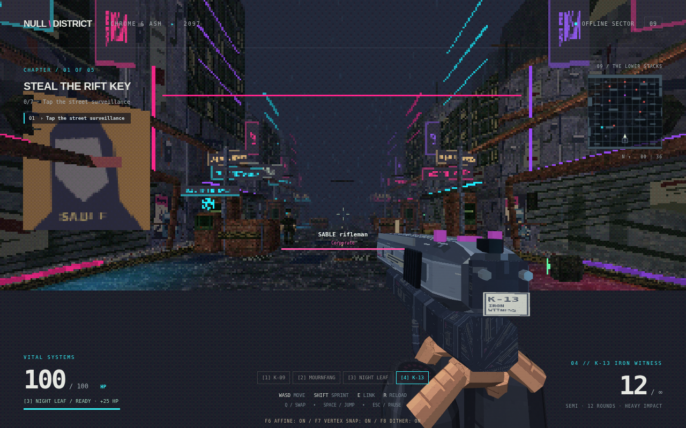

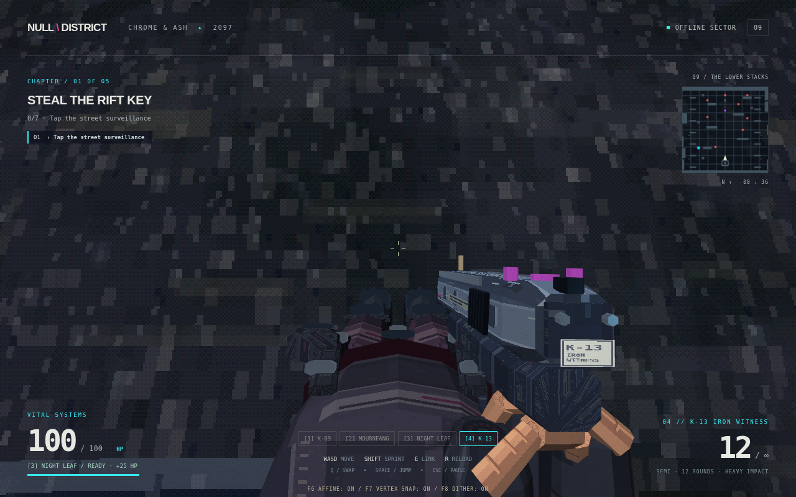

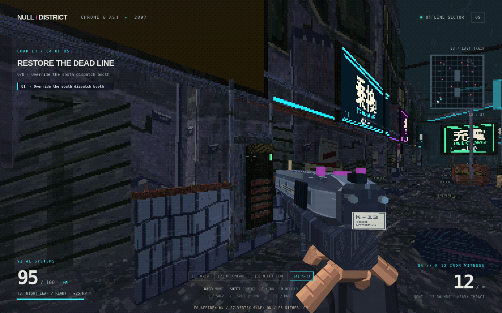

Version 1.8 adds **blood effects and NIGHT LEAF**, a permanently available marijuana blunt.

- Bullet hits spray blood from the actual impact point. Mournfang produces larger sprays; kills leave pools. Droplets fall onto the ground and nearby walls receive irregular stains. Stains linger for up to two minutes, with bounded particle/decal counts and clean chapter disposal.
- **3** equips NIGHT LEAF in every chapter. **Left click** raises it to the mouth, draws on the glowing ember, then exhales a drifting smoke cloud. The rolled brown leaf, spiral seam, ash, pinching fingers and articulated arm render with the sharp player-gear pass.
- A completed puff restores **25 HP**, capped at 100, on a **12-second cooldown** starting when the puff begins. The heal happens on exhale, not on clicking. Holstering or pausing cancels an unfinished inhale without granting health; the cooldown remains. Pausing freezes its timer, and campaign transitions carry its remaining cooldown. It is still available for a cosmetic puff at full health.
- **Q** cycles carbine → sword → blunt → pistol; the mouse wheel cycles in either direction. The HUD shows the third slot, readiness and remaining seconds even while another weapon is held. No ammunition or finite item charges are consumed.

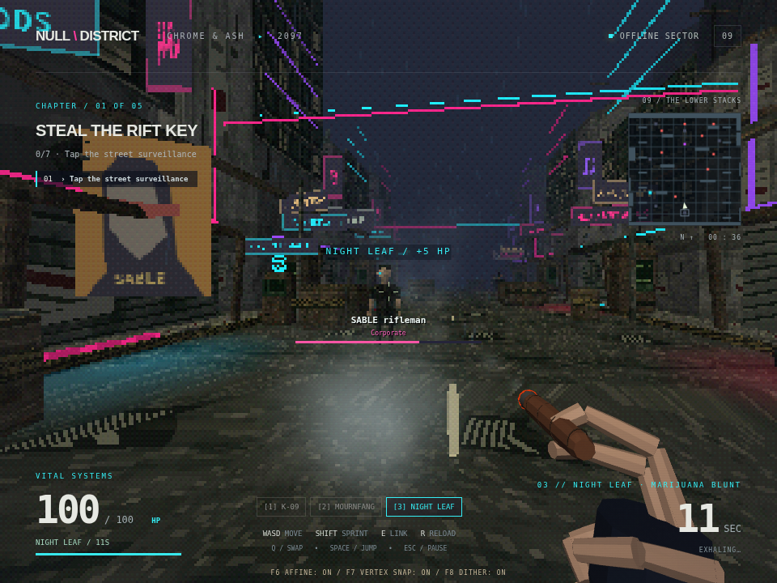

Version 1.7 reworks all five chapters into **38 objectives**, with routes extended by 65%, staged reinforcements and different mission mechanics:

| Chapter | Mission flow |
| --- | --- |
| 01 — Neon Schism | Tap surveillance, destroy two grid transformers, steal the rift key, defeat the retrieval ambush, deliver the key back to spawn and defend the gate while it charges. |
| 02 — Cathedral of Static | Recover a relic, cut two blood seals using Mournfang, deliver the offering, defend the ritual circle, shatter the exposed heart and defeat its warden. |
| 03 — Kabuki Aftermarket | Find the manifest, collect three memory cases, deliver them to the fence, protect decryption, destroy the tracker and recover the blacklist. |
| 04 — Shin-Kuro Terminal | Override dispatch, sabotage two train brake relays, fetch an ignition cell, install it, escort a moving courier through three encounters, retrieve its freight core and authorize departure. |
| 05 — Rainline Broadcast | Recover an access card, destroy both jammers, reroute the signal, defend a 24-second upload, defeat the regent, sever its antenna with Mournfang and transmit the shutdown. |

The tracker and cyan minimap markers identify available tasks. Locked tasks unlock through dependencies. **E** retrieves cargo, installs deliveries and operates consoles; damageable power cores take bullets or sword strikes, while blood seals require the sword. Defense timers pause when you leave their marked zones, and living reinforcements prevent completion. Start the courier with **E**, stay within five meters and clear nearby threats to keep it moving. Each completed task restores 12 health. Both weapons and unlimited reserve ammunition remain available.

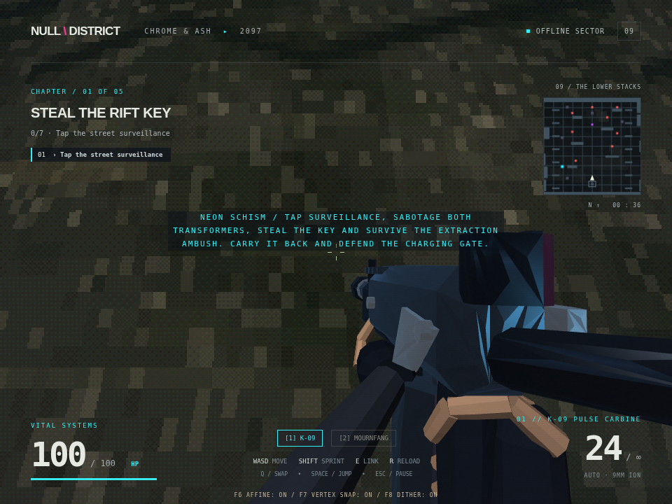

Close pavement now smoothly reduces affine distortion to 12% inside two meters, returning to the original full effect at seven meters. Walls, enemies, distant pavement, vertex snapping, dithering and native-resolution player gear retain their rendering behavior.

Every chapter remains directly selectable. Campaign transitions carry weapons, kills and elapsed time; chapter checkpoints replenish health and the magazine. Restart resets all task dependencies, cargo, courier position, reinforcements and timers.

The new districts contain **80 animated advertisement panels** using **17 bilingual designs**. Short Japanese headlines, bold English labels and large prices remain on-screen while illuminated frames and icons animate at a measured pace. Landscape and portrait panels use separately laid-out artwork, with actual stacked Japanese typography on tall signs. Main signs are physically large, high contrast and placed near routes so their lettering remains readable in the retro world raster. Distant signs still obey the world's pixel resolution, fog and affine warping.

The **District JP** subset of Noto Sans CJK JP is bundled locally under the SIL Open Font License. Japanese glyphs do not depend on Windows language packs or a network font service. The source ZIP includes the license and the font-subsetting helper. The Japanese headlines include 闇市 (night market), 記憶 (memory), 改造 (body modification), 夜食 (late-night food), 義眼 (prosthetic eyes), 終電 (last train), 出口 (exit), 乗換 (transfer), 運行停止 (service suspended) and 中央放送 (central broadcasting).

The existing grungy texture palette, retro world renderer, ten enemy types and native-resolution player gear remain. MOURNFANG retains its black-steel sheen and animated fittings. Dreadwake is untouched.

[View all advertisement designs](screenshots/japanese-advertisement-proof.png).

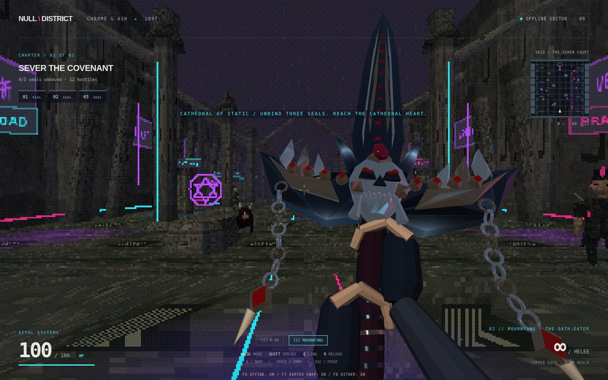

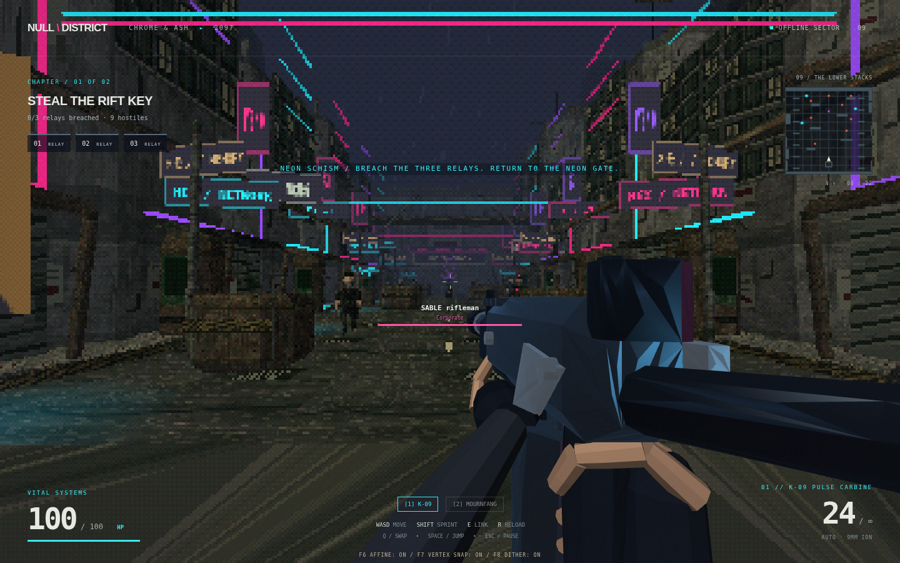

Version 1.5 separates **the player and gear** from **the world and enemies**. The environment and enemies retain affine texture warping, vertex snapping, nearest-neighbor pixelation, dithering and RGB555. Player arms, hands, carbine, sword and their attached effects render afterwards at the window’s native resolution with normal perspective interpolation, antialiased edges and continuous color. Retro toggles affect the world; they do not distort or pixelate the player’s gear.

**MOURNFANG, the black-steel sovereign**, is now a traditional straight, symmetrical double-edged longsword with a diamond-section blade and polished black steel. A moving specular sheen crosses its bevels, with view-dependent cool/warm reflections. The elaborate hilt retains and expands the cursed fittings: sculpted death mask, hollow burning eyes, horn crown, articulated silver talons, gilded filigree, ten animated blood runes, faceted gems, wrapped grip, crowned pommel, thorn finial and twin nine-link chains carrying jeweled tooth charms. Idle animation, two-handed contact, alternating slashes and blade-following trails remain.

The carbine gains additional sculpted mechanical planes, venting, fasteners, metallic inlays, connected sights and a moving bolt. The stock follows the shoulder outside the sight line. Player hands have denser faceted fingers and palms while retaining the same physical grip constraints.

All ten enemy types now use raised triangular surface topology, with more anatomical torso/arm/leg sections for human types. They range from 1,578 to 6,468 triangles, with joints and independently moving props preserved. Static sibling surfaces are merged by material within each joint to reduce draw calls. Environment geometry, textures, lighting palette, layouts and combat tuning are unchanged from version 1.4.

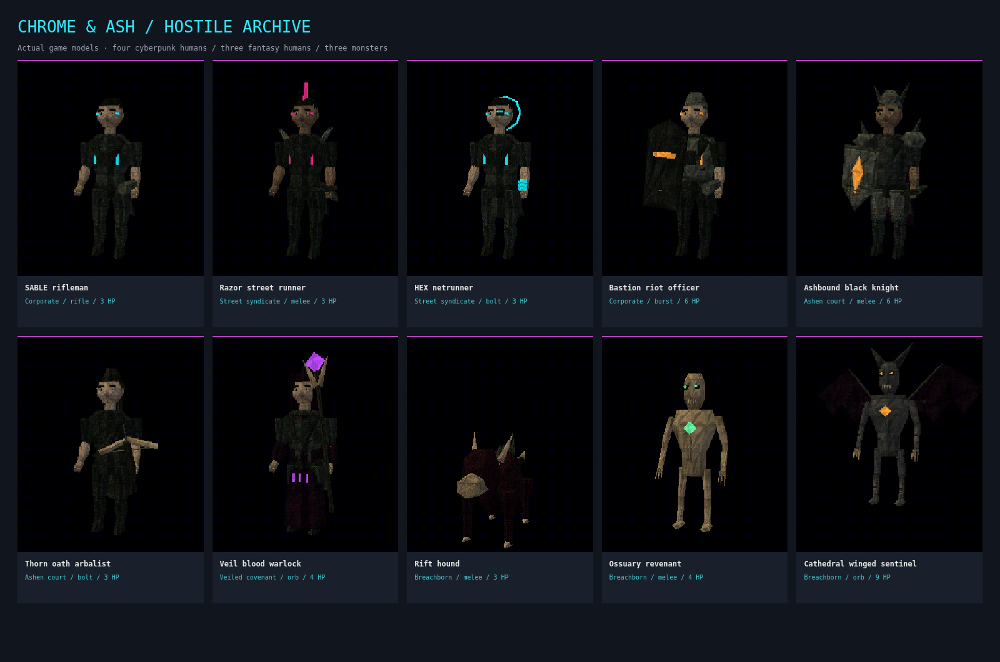

[See the animated black-steel sword in actual gameplay](screenshots/black-steel-animated.gif).

**Chrome & Ash** is a five-chapter collision of grunge cyberpunk and high/dark fantasy. Dirty concrete, corroded steel and worn fabric remain beneath a much stronger layer of cyan/magenta/violet signage, neon conduits, pixel-lit pavement and dimensional sigils. The affine shader, vertex snapping, dithering and RGB555 pipeline are unchanged.

**Chapter 01 — Neon Schism.** Corporate patrols and street syndicates defend the lower stacks as knights, spellcasters and a rift hound spill into the district. Sabotage the grid, steal the key and defend the gate at spawn. Choose **Enter Chapter 02** on the completion screen.

**Chapter 02 — Cathedral of Static.** A wider ruined cathedral with a nave, side chapels, flying buttresses, tombs, server racks and a shattered neon rose window. Recover the relic, cut blood seals with Mournfang, defend the ritual and destroy the covenant heart. A winged sentinel guards the final approach. This is a different map with its own bounds, cover, encounters and exit.

All chapters are selectable from the main menu. Starting Chapter 02 directly is supported. A campaign transition carries kills, elapsed time and both weapons; health and the magazine replenish at the chapter checkpoint. Restart resets the current chapter, including enemies, objectives, medkits and projectiles.

### Hostile archive

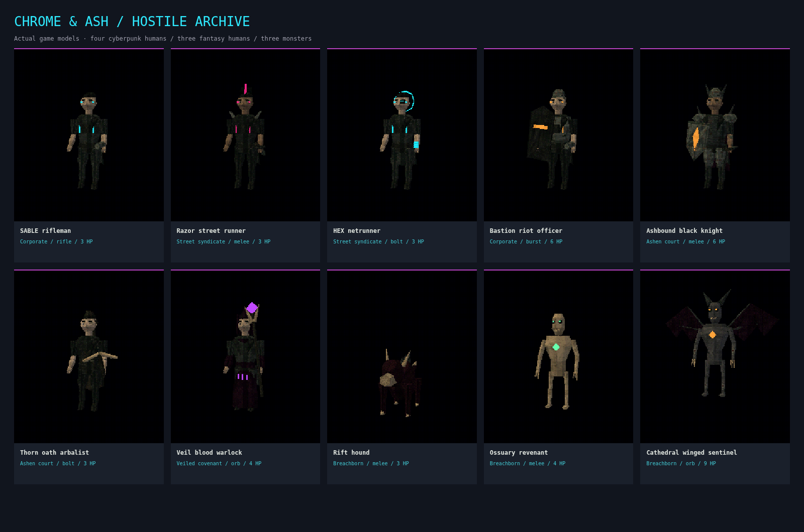

| Faction | Archetype | Combat |
| --- | --- | --- |
| Corporate | SABLE rifleman | Aimed rifle fire; 3 HP |
| Street syndicate | Razor street runner | Fast machete rush; 3 HP |
| Street syndicate | HEX netrunner | Dodgeable cyan data bolts; 3 HP |
| Corporate | Bastion riot officer | Shield/helmet silhouette, burst fire; 6 HP |
| Ashen court | Ashbound black knight | Plated armor, shield and long melee reach; 6 HP |
| Ashen court | Thorn oath arbalist | Cloak, hood and crossbow; 3 HP |
| Veiled covenant | Veil blood warlock | Robes, staff and slow blood-magic orbs; 4 HP |
| Breachborn | Rift hound | Spined quadruped with a fast biting rush; 3 HP |
| Breachborn | Ossuary revenant | Skeletal, jointed undead claw fighter; 4 HP |
| Breachborn | Cathedral winged sentinel | Large horned stone demon with animated wings and orbs; 9 HP |

These are actual polygonal meshes, not sprite substitutions. Seven human types retain exposed sculpted faces; three monster types use independent skeletons/silhouettes. Body counts range from 1,578 to 11,268 triangles, with the redesigned humans around 10,500–11,300 triangles. Melee and ranged attacks have visible wind-ups and expanding ground warnings. Moving out of reach, strafing the locked aim or taking cover can evade attacks. Bolts and orbs travel through the world and stop at solid cover; swept collision prevents fast projectiles tunneling through the player. Targeting an enemy displays its faction, name and remaining health.

The two starting weapons retain their articulated first-person grips and fixed-length arm IK. MOURNFANG animates its talons, runes, ruby, linked chains and steel sheen at rest, and alternates slashes with a blade-following trail. Armored enemies need two sword hits. Dreadwake remains untouched.

## Play on Windows

1. Download **[NULL-DISTRICT-1.16.0-Windows-x64.exe](https://github.com/jirotwo-create/browser-game/raw/refs/heads/codex/null-district-fps/NULL-DISTRICT-1.16.0-Windows-x64.exe)** from this branch. If GitHub opens a file page, choose **Download raw file**.
2. Double-click the downloaded `.exe`. It opens its own game window. No installation, browser, Python, Node.js, server, internet connection or additional game files are needed.
3. Choose **Enter the district**.

Requires **64-bit Windows 10 or Windows 11**, a graphics driver with WebGL support, and keyboard/mouse. The executable is an unsigned prototype build. `null-district.zip` is the source code, not the Windows game.

- **WASD** move, **mouse** aim, **left click / hold** fire the carbine or swing MOURNFANG.
- All equipment is available immediately: **1** equips the carbine, **2** equips the sword. **3** equips the marijuana blunt; left click smokes it for up to 25 HP on a 12-second cooldown. **Q** or the **mouse wheel** cycles all four items. **4** equips the K-13 pistol, with its own 12-round magazine; **R** reloads it.
- MOURNFANG has a 2.8m melee reach, a visible wind-up, a sweeping attack and a recovery cooldown. It can cleave nearby enemies for 3 damage, respects cover and never consumes bullets. Switching weapons cancels an unfinished swing or reload; it does not refill the magazine.
- **Shift** sprint, **Space** jump, **R** reload, **Escape** pause.
- **F6** compares affine and perspective-correct texture mapping. **F7** toggles vertex snapping; **F8** toggles dithering. These retro effects start enabled.
- **F11** or **Alt+Enter** toggle fullscreen. Close the window or use **Alt+F4** to quit.
- Follow the active mission tracker. Cyan minimap squares mark available objectives; dark markers are locked, green markers are complete. Use **E** at the marked exit once the entire mission chain is complete.
- Rotating cross-marked crates restore 40 health when walked over. Ammunition reserves are unlimited; magazines hold 24 rounds.
- The pause and end screens let you restart. Progress lasts for the current run only; chapter selection is always available.

## Desktop build from source

The executable bundles Electron, the game and all graphics. The desktop launcher serves files through an in-process local protocol; it does not run an HTTP server or open an installed browser. The renderer is sandboxed with Node.js disabled and context isolation enabled.

For development, install Node.js 24 LTS. From the repository root or extracted source ZIP:

```sh
cd null-district
npm ci
npm start
```

Create a single portable Windows executable:

```sh
npm run dist:win
```

Output: `dist/NULL-DISTRICT-1.16.0-Windows-x64.exe`. The pinned dependencies and lockfile reproduce the build. The Windows target is x64; no signing certificate is configured. The build can also be produced on Linux without Wine. Downloading dependencies and runtime binaries requires internet access at build time only.

`npm run preview` retains the optional browser development workflow on port 4180. Python 3 is needed only for that optional preview.

## Rendering and validation

The [graphics pipeline documentation](graphics/README.md) describes the renderer, authored polygon budgets, texture palette and GPU interpolation test. Three.js 0.180.0 is bundled under its MIT license in `vendor/`. Audio is synthesized locally.

```sh
npm run check
node tests/desktop.cjs
```

Desktop tests use Playwright from `/workspace/dreadwake-tools` by default; set `PLAYWRIGHT_MODULE` to another installation. Linux desktop tests need a display (or Xvfb); Windows can use its normal desktop. The desktop smoke test exercises local module loading, WebGL, real mouse capture, movement, both starting weapons, a sword swing, shooting, reload, pause/restart, fullscreen and renderer isolation. Set `ELECTRON_EXECUTABLE` and `NULL_DISTRICT_APP` to test a packaged build.

With `npm run preview` running, `node tests/render.cjs` verifies real GPU affine interpolation against CPU barycentrics, vertex snapping and RGB555 output.

`node tests/signage.cjs` verifies the bundled font, text fit, panel aspect ratios and fixed readable headlines across animation phases. `node tests/chapters.cjs` checks all five chapter selections, clear spawns, routes to all objectives/exits, in-world ad animation and restart. The packaged desktop test also loads the bundled font and all five chapters offline.

`node tests/composite.cjs` reads back real GPU pixels: the world remains nearest-scaled pixel blocks, retro toggles leave native gear unchanged, gear preserves more than 32 channel levels, and the animated black-steel sheen changes actual framebuffer pixels.

`node tests/grips.cjs` checks 223 recoil/reload/alternating-swing poses for fixed arm lengths, wrist attachment, trigger contact, wrapped fingers, correct left/right anatomy, visible hands and animated blade parts.

`node tests/weapons.cjs` verifies starting inventory, the mixed enemy roster, weapon switching, melee range, one hit per swing, cooldown, lethal melee damage, ammunition preservation, reload cancellation and restart.

`node tests/missions.mjs` checks every mission dependency, damageable core, sword requirement, zone timer, escort pause condition, reinforcement wave and restart.

`node tests/clarity.cjs` checks the floor’s high-frequency noise and structural contrast, clean default presentation, optional light dithering, 360-line raster and measured human torso slimming. The pistol art test also checks that the weapon stays below the center of view and farther from the eye.

`node tests/pistol.cjs` exercises actual two-damage hits, blood, semi-auto held-trigger behavior, magazine independence, reload cancellation, empty slide lock and restart. `node tests/pistol-art.cjs` verifies 36 recoil/reload/empty poses, fixed arm lengths, trigger and wrist contact, visible walking body pixels, point-filtered painted maps and native-resolution isolation.

`node tests/smoking.mjs` verifies heal timing, cooldown, cancellation, health caps and resets. `node tests/blood-blunt.cjs` uses real inputs to shoot an enemy, receive a wound, smoke to recover health, and verify the permanent slot, cooldown and restart. `node tests/blood-visuals.cjs` checks rendered blood pixels, wall splatter, bounded particle/decal counts, cleanup and the smoking arm’s wrist contact and bone lengths through its animation.

`node tests/combat.mjs` checks telegraphs, attack cooldowns, melee facing/range/cover, locked firearm aim, projectile launch and swept collisions. `node tests/roster.cjs` checks all ten actual enemy meshes and animated joints; `tests/roster.html` is the model review scene.

With the preview running, `node tests/campaign.cjs` plays all five chapters using real mouse/keyboard input: combat, navigation, all 38 varied objectives, sequential chapter transitions, carried inventory/kills, final victory, restart and chapter selection. Set `START_CHAPTER=3` to start the playthrough from the new chapters. It does not teleport the player, grant health or force objectives. `node tests/mission.cjs` runs the same campaign test; `node tests/smoke.cjs` retains basic controls coverage. The desktop package and its equivalent Linux build have matching game code/assets; the packaged Linux desktop workflow was tested here. The Windows executable was cross-built and its contents verified, but it has not been run on a Windows machine in this environment.

This prototype has five handcrafted chapters. Touch controls and multiplayer are not implemented.
